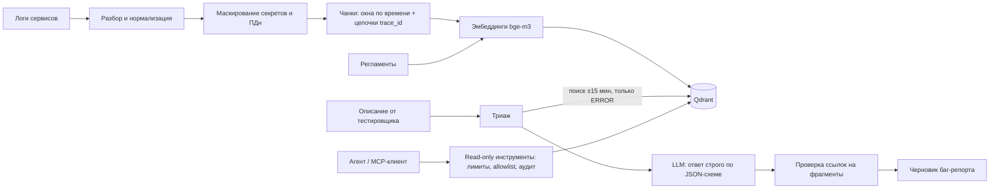

# log-triage-assistant


Ассистент для первичного разбора инцидентов на тестовом стенде. Тестировщик пишет, что сломалось и примерно когда. Ассистент находит нужные фрагменты логов нескольких сервисов, определяет тип проблемы, называет вероятную причину и готовит черновик баг-репорта со ссылками на строки логов.

Это воспроизведение внутреннего инструмента, который я делал для команды тестирования на прошлой работе. Оригинал и реальные логи остались у работодателя, поэтому здесь та же архитектура на синтетических логах. Генератор создаёт стенд из шести сервисов и 16 инцидентов, причина которых известна заранее, — на них считаются метрики качества.

## Как устроено



**Подготовка логов** (`triage/logparse.py`). Строки разбираются, стектрейсы приклеиваются к своей записи. Логи режутся двумя способами: окнами по 5 минут внутри сервиса и цепочками одного `trace_id` сквозь сервисы, если в цепочке есть WARN или ERROR. Первые находят «что творилось в сервисе в это время», вторые — сквозной путь упавшего запроса. Повторяющиеся строки внутри чанка схлопываются по шаблону (числа, id и IP заменяются метками), чтобы шум не забивал эмбеддинг.

**Маскирование** (`triage/masking.py`). JWT и Bearer-токены, пароли в строках подключения, `password=…` и `api_key=…`, e-mail, телефоны и номера карт заменяются метками. Это происходит до индексации и в каждом ответе инструментов, поэтому ни в индекс, ни в LLM исходные значения не попадают.

**Поиск** (`triage/store.py`). Используется Qdrant со встроенным хранилищем: сервер не нужен, индекс лежит в `data/index`. Эмбеддинги bge-m3 — мультиязычная модель, поэтому русское описание тестировщика находит английские строки логов. Время из описания («около 14:30») превращается в фильтр ±15 минут, плюс фильтр «только чанки с ERROR».

**Анализ** (`triage/pipeline.py`). LLM получает найденные фрагменты и подходящие регламенты и отвечает по JSON-схеме: категория, уверенность, что случилось, причина, id фрагментов-доказательств, следующие шаги. Ссылки на фрагменты, которых не было в выдаче, отбрасываются — сослаться на выдуманное модель не может. Баг-репорт собирается по шаблону из проверенных полей. Если LLM не подключена или ответила не по схеме, категория определяется по правилам, и разбор всё равно работает.

**Агент и MCP** (`triage/agent.py`, `triage/mcp_server.py`). Четыре инструмента: `list_services`, `search_logs`, `get_log_window` и `search_runbooks`. Их можно вызывать из агентного цикла с function calling или из любого MCP-клиента.

## Безопасность инструментов

- **Только чтение.** Инструментов, которые что-то меняют, нет. В MCP они помечены `readOnlyHint=true` и `destructiveHint=false`.
- **Сервис только из списка известных.** Произвольный путь передать нельзя: `../../etc/passwd` получит отказ.
- **Лимиты.** Окно выгрузки — до 15 минут, до 200 строк, до 10 результатов поиска.
- **Маскирование всего, что уходит наружу.**
- **Журнал аудита.** Каждый вызов, в том числе отклонённый, пишется в `data/audit.jsonl`, его видно в веб-интерфейсе.
- **Ошибки как данные.** Ошибка ограничения возвращается агенту текстом, и он может сузить запрос сам.

## Запуск

Нужен Python 3.10+, Linux, macOS или WSL. Видеокарта не нужна.

```bash
python3 -m venv .venv && source .venv/bin/activate
pip install torch --index-url https://download.pytorch.org/whl/cpu   # CPU-сборка, без CUDA
pip install -r requirements.txt
cp .env.example .env

python -m triage generate      # синтетические логи стенда и 16 инцидентов
python -m triage index         # индекс; в первый раз скачает bge-m3 (~2,3 ГБ)
streamlit run app.py           # веб-интерфейс на http://localhost:8501
```

На слабом ноутбуке можно взять модель поменьше: `EMBEDDER=intfloat/multilingual-e5-small` в `.env`, затем `python -m triage index`. Без интернета подойдёт `EMBEDDER=hashing`.

**LLM** подключается через OpenAI-совместимый API, примеры для Gemini и Ollama — в `.env.example`. Без LLM работает режим правил.

Команды без веб-интерфейса:

```bash
python -m triage incidents                       # описания инцидентов (с --answers — истинные причины)
python -m triage triage "Тест печати этикеток упал около 09:51: принтер не отвечает"
python -m triage search "printer not accessible" --service device-agent --errors-only
python -m triage window device-agent 09:50 09:52
python -m triage agent "Почему около 10:15 перестали формироваться отчёты?"
python -m triage eval                            # метрики на всех инцидентах → results/eval.json
```

## MCP

```bash
python -m triage mcp     # stdio-сервер
npx @modelcontextprotocol/inspector .venv/bin/python -m triage mcp   # посмотреть и вызвать инструменты в браузере
```

Claude Desktop на Windows с проектом внутри WSL (`claude_desktop_config.json`):

```json
{
  "mcpServers": {
    "log-triage": {
      "command": "wsl",
      "args": ["-e", "bash", "-lc", "cd ~/log-triage-assistant && .venv/bin/python -m triage mcp"]
    }
  }
}
```

Встроенный Qdrant открывает индекс только из одного процесса. Если веб-интерфейс и MCP нужны одновременно, запустите Qdrant в Docker (`docker run -p 6333:6333 qdrant/qdrant`), пропишите `QDRANT_URL=http://localhost:6333` и пересоберите индекс.

## Оценка качества

`python -m triage eval` прогоняет все инциденты и считает:

- **hit@k и MRR** — попал ли в выдачу фрагмент со строками инцидента и на какой позиции. Считается со временем из описания и без него.
- **Точность классификации** — совпала ли категория с истинной.
- **Evidence precision** — какая доля фрагментов, на которые сослался анализ, действительно относится к инциденту.

Синтетические инциденты чище реальных, поэтому цифры здесь — проверка, что цепочка работает, а не оценка качества на продакшен-логах.

## Тесты

```bash
pip install -r requirements-dev.txt
ruff check . && pytest -q
```

Тесты не скачивают модели и не ходят в сеть: эмбеддинги hashing, Qdrant в памяти, LLM — фейковая или локальный фейковый OpenAI-сервер. Проверяются:
- маскирование и разбор логов;
- ограничения инструментов и аудит;
- отбрасывание выдуманных ссылок на фрагменты;
- переход на правила при сбое LLM;
- агентный цикл и лимит шагов;
- MCP-сервер;
- веб-интерфейс через Streamlit AppTest.

## Что изменилось бы в продакшене

- LLM внутри контура (vLLM с open-source моделью) вместо внешнего API.
- Маскирование ПДн моделью NER, а не только регулярными выражениями.
- Права на инструменты по ролям.
- Оценка на размеченных реальных инцидентах и мониторинг доли разборов, которые тестировщики приняли без правок.

## Структура

```
triage/
  synth.py        генератор стенда и инцидентов
  logparse.py     разбор, нормализация, чанки
  masking.py      маскирование секретов и ПДн
  embedder.py     bge-m3 / e5 / hashing
  store.py        индекс в Qdrant
  tools.py        read-only инструменты: лимиты, allowlist, аудит
  pipeline.py     триаж: поиск → анализ → баг-репорт
  agent.py        агентный цикл с function calling
  mcp_server.py   MCP-сервер
  evaluate.py     метрики на инцидентах
  cli.py          команды python -m triage …
app.py            веб-интерфейс (Streamlit)
runbooks/         регламенты по известным проблемам
tests/            pytest, без сети и GPU
```
